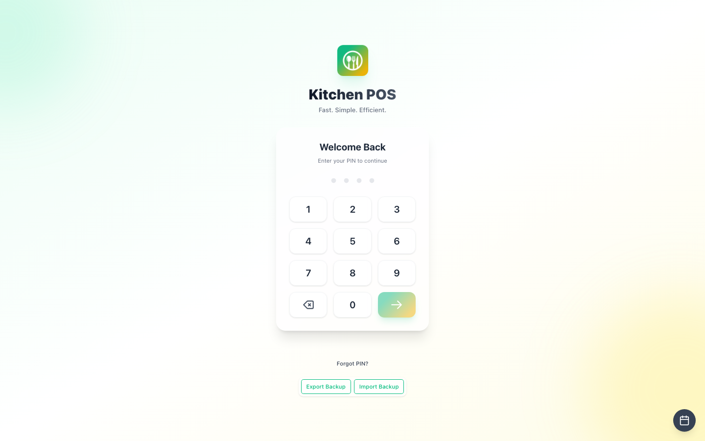
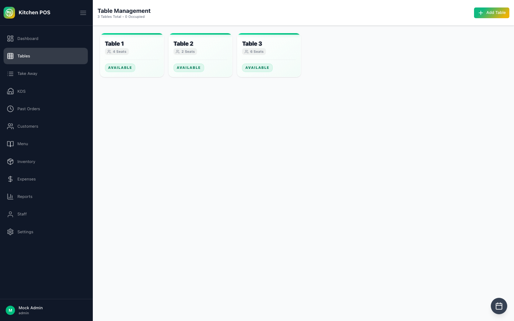
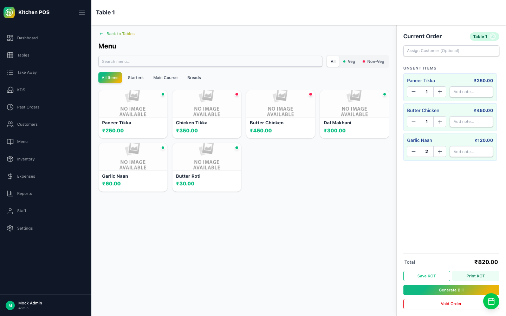
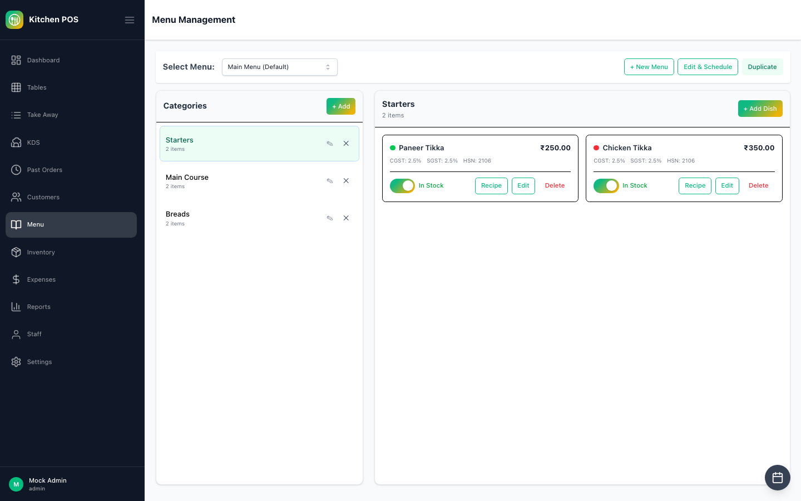
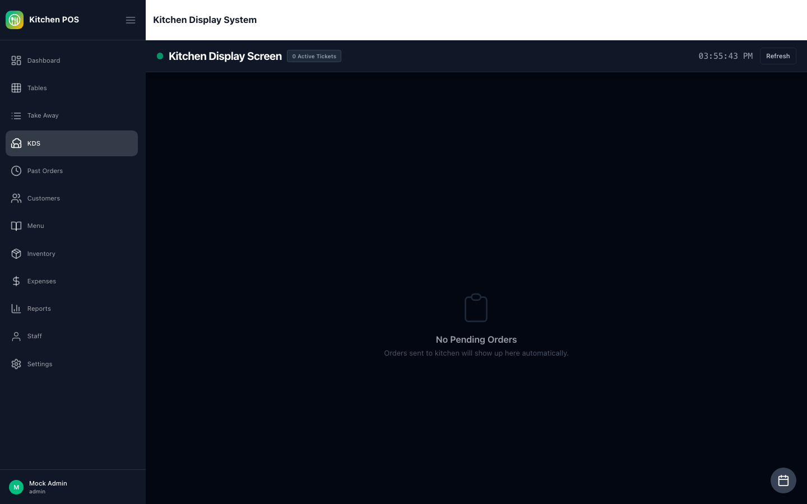
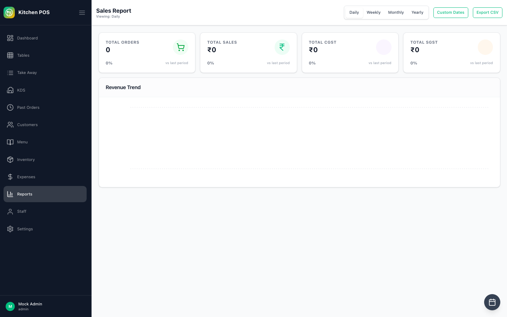
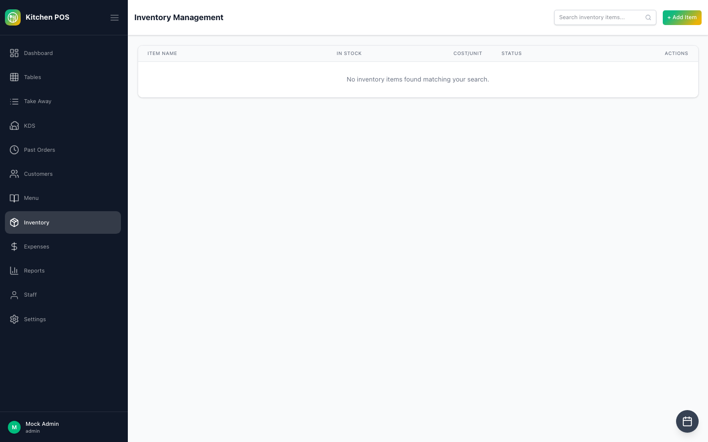
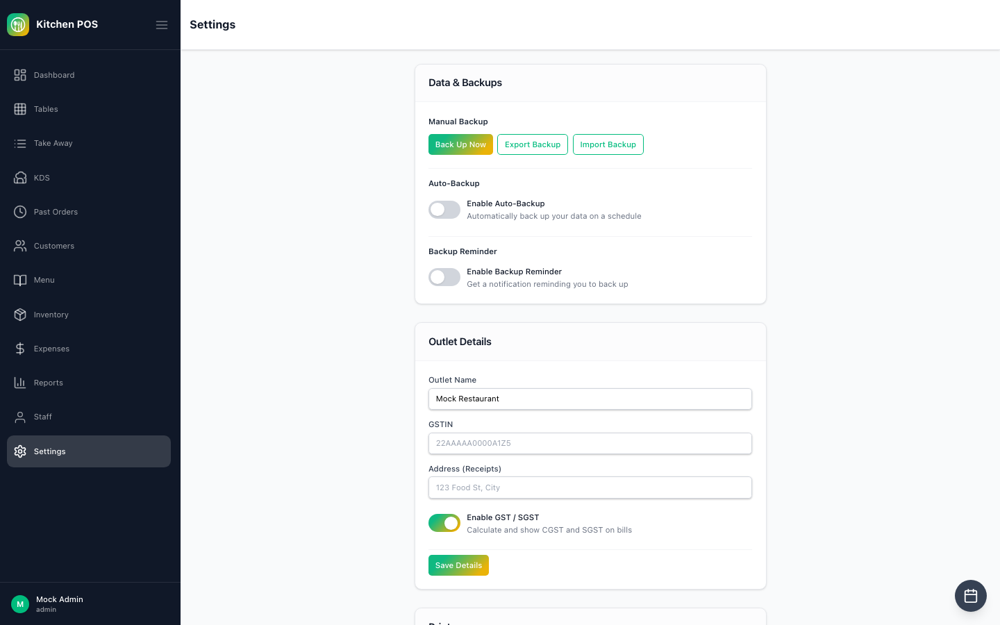

<div align="center">



# Kitchen POS

**Open-source, offline-first restaurant POS for Windows & macOS** — GST-compliant billing, table management, kitchen display, inventory, staff and reports. Runs entirely on a single machine with no internet, no subscription, and no cloud dependency.

[](./LICENSE)
[](package.json)
[](package.json)
[](package.json)
[](package.json)
[](docs/technical/)
[](./CONTRIBUTING.md)

[Quick Start](#quick-start) · [Features](#features) · [Screenshots](#screenshots) · [Architecture](#architecture) · [Testing](#testing) · [Contributing](#contributing) · [Roadmap](#roadmap)

</div>

---

## What this is

**Kitchen POS** is a purpose-built, offline-first point-of-sale and restaurant management system for dine-in and takeaway operations. The entire application — UI, API, and database — runs as a single Electron process on the restaurant's own machine. Orders, billing, and printing all keep working with no network connection at all.

It is designed for **Indian restaurants** with GST-compliant billing (CGST + SGST per line, HSN codes, tax-inclusive pricing), but the core POS and management features work anywhere.

---

## Screenshots

<table>
  <tr>
    <td align="center"><br><b>PIN Login</b></td>
    <td align="center"><br><b>Table Management</b></td>
  </tr>
  <tr>
    <td align="center"><br><b>Order Taking</b></td>
    <td align="center"><br><b>Menu Management</b></td>
  </tr>
  <tr>
    <td align="center"><br><b>Kitchen Display (KDS)</b></td>
    <td align="center"><br><b>Sales Reports</b></td>
  </tr>
  <tr>
    <td align="center"><br><b>Inventory</b></td>
    <td align="center"><br><b>Settings</b></td>
  </tr>
</table>

---

## Features

### Core POS
- **Table management** — Visual floor plan, status colours (available / occupied / bill requested), section support
- **Order taking** — Open table → add items by category → send KOT to kitchen
- **Take Away** — Separate flow for counter / takeaway orders
- **GST-compliant billing** — CGST + SGST per line item, HSN codes, sequential GST invoice numbers, tax-inclusive pricing backed out correctly
- **Payment methods** — Cash, card, UPI, and complimentary
- **Shift register** — Cash drawer float, open/close shift with reconciliation

### Kitchen
- **Kitchen Display System (KDS)** — Live ticket view with bump buttons, status tracking
- **KOT printing** — Direct USB ESC/POS thermal printing from the Electron main process
- **Bill printing** — Formatted GST receipt via ESC/POS

### Management
- **Menu management** — Categories, items, veg/non-veg flag, availability toggle, price and tax configuration
- **Inventory tracking** — Stock levels, auto-deduction on sale via recipe map, low-stock alerts, inventory log
- **Staff management** — PIN-based login, 4 roles (admin / manager / cashier / waiter), shift tracking
- **Customer CRM** — Customer records, order history, search
- **Expense tracking** — Log and categorise business expenses

### Reports & Analytics
- **Daily summary** — Total orders, revenue, GST breakdown
- **GST report** — CGST + SGST collected per period
- **Payment method breakdown** — Cash vs card vs UPI split
- **Revenue trend** — Daily / weekly / monthly / yearly with custom date range
- **CSV export** — Export any report to CSV

### System
- **Backup & restore** — Export the SQLite database as a `.sqlite` file; import restores the full state
- **Factory reset** — Wipe all data and start fresh
- **Outlet configuration** — Business name, address, GSTIN, HSN defaults
- **Offline-first** — Zero network dependency; all data is local SQLite

---

## Quick Start

### Prerequisites

- [Node.js](https://nodejs.org/) ≥ 20
- [npm](https://www.npmjs.com/) ≥ 9
- Windows 10+ or macOS 12+

### Development

```bash
git clone https://github.com/your-org/kitchen-pos.git
cd kitchen-pos
npm install
npm run dev
```

`npm run dev` starts:
1. The frontend Vite dev server on `http://localhost:5205`
2. The Electron backend (SQLite, IPC handlers)
3. Electron opens pointing at the dev server

The default admin PIN is `1234` on a fresh database.

### Production Build

```bash
npm run build      # build frontend + backend
npm run package    # package with electron-builder → dist/
```

Output: `dist/Kitchen POS Setup.exe` (Windows) or `dist/Kitchen POS.dmg` (macOS).

### First-Run Setup

1. Launch the app — the setup wizard runs automatically on a fresh database.
2. Enter your restaurant name, address, GSTIN, and tax rates.
3. Add your menu categories and items.
4. Add tables and staff PINs.
5. Open a shift to begin billing.

---

## Architecture

```
kitchen-pos/
├── backend/               # Electron main process
│   ├── src/
│   │   ├── main.ts        # Electron entry point, window management
│   │   ├── database/      # SQLite connection, migrations, WAL config
│   │   ├── ipc/           # IPC channel handlers (orders, menu, billing…)
│   │   └── services/      # Business logic (tax calculation, printing…)
│   └── dist/              # Compiled output (main.js)
│
├── frontend/              # Electron renderer process (React SPA)
│   ├── src/
│   │   ├── pages/         # Route-level components (Tables, Order, KDS…)
│   │   ├── components/    # Atomic Design: atoms / molecules / organisms
│   │   ├── store/         # Zustand slices
│   │   ├── hooks/         # Shared React hooks
│   │   └── lib/           # Utilities, IPC client wrapper
│   └── icons/             # SVG source → public/sprite.svg via build script
│
└── package.json           # Root scripts: dev, build, package
```

### Key Design Decisions

| Decision | Rationale |
|----------|-----------|
| **Electron + SQLite** | True single-machine offline — no server process, no Docker, no LAN dependency |
| **IPC via contextBridge** | Renderer has no direct Node access; all backend calls go through `window.api.invoke('module:action', payload)` |
| **WAL mode** | SQLite write-ahead logging gives concurrent read performance without a separate connection pool |
| **Custom migration runner** | Numbered SQL migration files; schema version tracked in `schema_version` table; rollback-copy before each migration |
| **Atomic Design components** | `atoms/` → `molecules/` → `organisms/` — prevents prop-drilling anti-patterns, keeps reuse obvious |
| **Tailwind CSS 4** | CSS-first config, custom brand tokens, zero runtime overhead |

### IPC Channel Convention

```typescript
// Renderer (frontend)
const result = await window.api.invoke('orders:create', { tableId, items });

// Main process (backend)
ipcMain.handle('orders:create', async (event, payload) => {
  return ordersService.create(payload);
});
```

All channels follow `module:action` naming. See [`docs/technical/`](docs/technical/) for the full channel reference.

---

## Testing

See [docs/testing.md](docs/testing.md) for the full guide. Quick summary:

### Unit & Integration Tests (Vitest)

```bash
cd frontend
npm run test          # run once
npm run test:watch    # watch mode
npm run test:coverage # with coverage report
```

Tests live next to the code they test (`*.test.ts`, `*.spec.ts`). Current coverage: auth context, utility functions.

### E2E Tests (Playwright)

```bash
npm install           # installs playwright-core at root
node screenshot-tool.mjs   # smoke-test: launches app, screenshots each page
```

A full Playwright e2e suite is on the roadmap. See [`docs/testing.md`](docs/testing.md) for the plan.

---

## Roadmap

| Phase | Status | Scope |
|-------|--------|-------|
| Core POS & billing | ✅ Done | Tables, orders, KOT, GST bill, shift register |
| Business-day filters | ✅ Done | Open/close business day, daily report scoping |
| Live table totals | ✅ Done | Running total shown on occupied table cards |
| Settings refactor | 🔧 In progress | Break `SettingsPage` into sub-components (`refactor/settings-page`) |
| Menu modifier groups | 📋 Planned | Add-ons, variants, price adjustments per item |
| Reservations | 📋 Planned | Name, date/time, table assignment, status flow |
| Granular RBAC | 📋 Planned | Per-permission toggles per role (beyond 4 fixed roles) |
| Real-time push | 📋 Planned | IPC broadcast across Electron windows for KDS / tables |
| i18n | 📋 Planned | English is only language today |
| CI pipeline | 📋 Planned | GitHub Actions: build + test on push |

---

## Contributing

Contributions are welcome. Please read [CONTRIBUTING.md](./CONTRIBUTING.md) before opening a PR.

**For bugs and feature requests**, open a [GitHub Issue](../../issues).

**For direct assistance or to request a feature**, email: [asif.ansari7774@gmail.com](mailto:asif.ansari7774@gmail.com)

---

## License

[MIT](./LICENSE) © Asif Ansari
